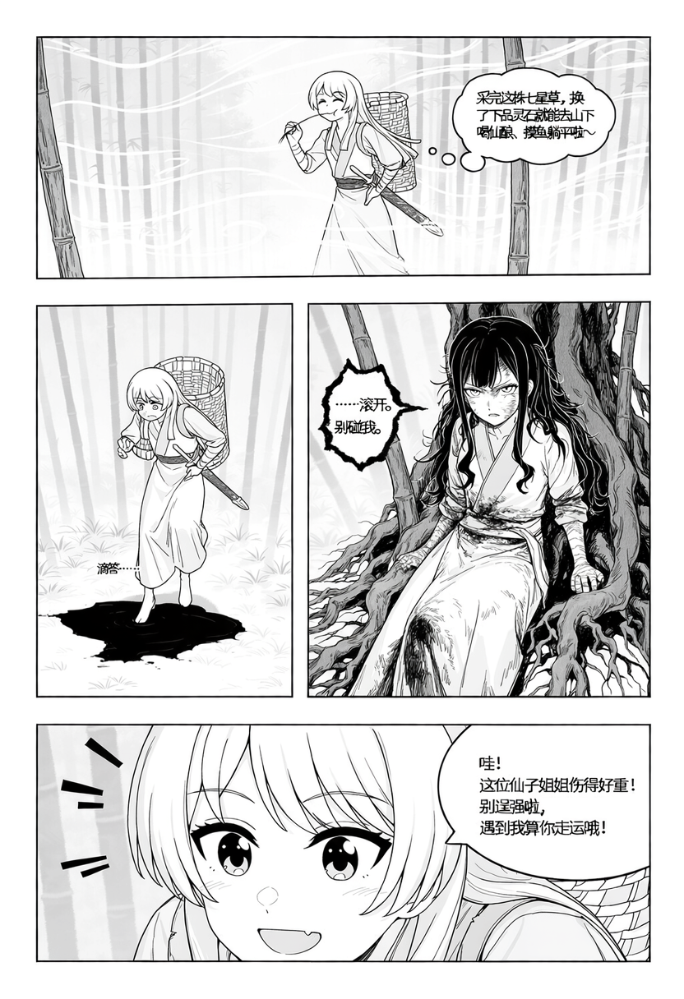

# novelManga

用 NovelAI 的主提示词和 Character Prompts 编排漫画整页，包含可安装的 Codex 技能及实际生图样例。

## 能做什么

- 把剧情、对白转成主提示词、逐格内容槽和负向提示词。
- 分开管理人物身份、画格和槽位，同一人物可在多个画格重复出现。
- 编排大小格混排、跨行竖格、通栏大格与局部插入格，并明确阅读顺序。
- 保留中文对白，通过 novelai-cli 的 dry-run 和实际图像分别检查参数与结果。

Character 槽用于引导画格内容与主体位置，不能保证精确的画框边界。

## 安装与使用

将 [skills/novelai-panel-manga](skills/novelai-panel-manga) 文件夹复制到 Codex 的 skills 目录，例如 Windows 下的 `%USERPROFILE%\.codex\skills\`。

调用示例：

```text
使用 $novelai-panel-manga 把这段剧情编成有大小格变化的漫画整页，
先给版式草图和阅读顺序，再给主提示词与 character 槽，保留原台词。
```

技能入口：[SKILL.md](skills/novelai-panel-manga/SKILL.md)。自由版式方法与例子：[flexible-layouts.md](skills/novelai-panel-manga/references/flexible-layouts.md)。

## 生图样例

### 不等大四格：竹林相遇

两个故事人物对应四个内容槽，出场顺序为 A / A / B / A。



[请求](artifacts/bamboo-four-panel/request-revision-1.json) · [验证记录](artifacts/bamboo-four-panel/verification.md)

### 规则四格：练习成果

爱音与素世的对白，采用 2×2 布局。


[请求](artifacts/anon-practice-gray-domain/request.json) · [验证记录](artifacts/anon-practice-gray-domain/verification.json)

### 自由分镜：五个主格加一个插入格

沿用同一段对白：通栏开场、左侧跨行竖格、右侧上下小格、通栏结尾及内嵌手机特写。


[版式计划](artifacts/anon-flexible-page/layout-plan.json) · [请求](artifacts/anon-flexible-page/request-revision-1.json) · [验证记录](artifacts/anon-flexible-page/verification.json)

## 用 novelai-cli 复现

需要可用的 NovelAI 账号和已配置凭证的 `novelai-cli`。样例使用 CLI 0.1.4、V5 Full；本仓库不包含 CLI 或账号凭证。

在仓库根目录执行：

```powershell
novelai-cli generate --request 'artifacts/anon-flexible-page/request-revision-1.json' --dry-run
novelai-cli generate --request 'artifacts/anon-flexible-page/request-revision-1.json' --output-dir 'outputs'
```

`--request` 接收 JSON 文件路径。每组样例保存请求、dry-run payload、实际生成记录、图片和检查结果。部分原始记录包含生成时的本机路径，复现时使用上面的仓库相对路径即可。

## 验证范围

技能结构校验、UTF-8 编码、内部引用和原有四槽请求的 dry-run 均已检查。上述样例经过实际生图与目视检查，其中自由版式完成过一次针对插入格边框的修订。

中文没有经过 OCR 逐字核验，跨 seed 稳定性未测试。斜格、破框、出血已有提示词编排规则，尚未逐项生图验证。部分样例未遵循 `monochrome`；`gray domain` 画师标签的识别效果也未确认。
